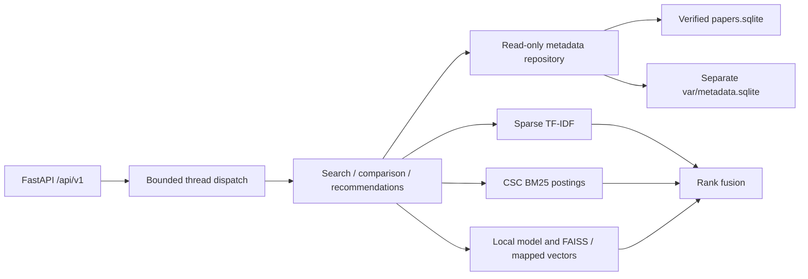

# Search backend architecture

The modular FastAPI monolith connects HTTP routes to request-local search orchestration, three retrieval adapters, a mathematical RRF merger and a read-only repository. Existing offline pipeline files remain unchanged. `bm25_scores` and the persisted lexical tokenizer/transformer are reused directly rather than refitting or replacing the algorithms.

`config.py` provides Pydantic Settings, repository-root paths and explicit CORS origins. `resources.py` loads all indexes and the original local Sentence Transformer once in the lifespan. Compatibility checks cover manifest/corpus versions, mapping hashes and ordered SQLite IDs, sparse dimensions/configuration, BM25 parameters, FAISS dimensions/metric, embedding probes, local model-file fingerprints, package versions and metadata-cache provenance. Startup does not recompute corpus embeddings or run full-corpus verification. Resource failures keep liveness available and make readiness/search return HTTP 503.

`prepare_metadata.py` creates an application-owned database outside protected directories. The verified SQLite corpus stores authors as display text; the separate cache obtains ordered names from the official snapshot, checking every selected normalized record and the full source checksum. It also indexes category relationships, subjects and original publication years. There are 47,698 usable structured author lists and 2,302 explicit raw-text fallbacks. The cache is linked to the exact verified dataset manifest. It can be recreated separately; no migration or write to the original database occurs.

`repository.py` uses request-local SQLite connections with URI `mode=ro` for both attached databases and `PRAGMA query_only=ON`. Eligibility is resolved once per search/comparison. IDs are mapped through the authoritative ID-to-position dictionary rather than assumed SQL order. Metadata is batch-loaded in chunks of 500 and assembled in ranking order. Secondary categories use the indexed relationship table. Author substring matching uses NFKC plus Unicode case folding and whitespace normalization; percent/underscore characters are literal, not SQL wildcards.

`services.py` prepares a lexical query once, embeds a semantic query once when needed, runs eligible rankers, calculates RRF, loads metadata, and adds truthful explanations/timings. Comparison shares eligibility, preparation, embedding and metadata across modes. Recommendations use the source document's saved vector and exclude itself; they never generate new document embeddings.

The default server runs one process. Two bounded request workers offload synchronous CPU/SQLite work; admission waits at most one second before HTTP 503. Inference is protected by a model lock. FAISS read-only search, mapped embeddings and immutable sparse storage are shared. The event loop remains responsive; a capacity test checks liveness while retrieval is busy. Cancellation retains its admission slot until the actual worker completes. Shutdown drains the workers, releases the model and closes the embedding map. Use the provided launcher/commands to avoid multiple model copies and query access logging.

This follows FastAPI's [lifespan resource pattern](https://fastapi.tiangolo.com/advanced/events/) and [Pydantic Settings](https://docs.pydantic.dev/latest/concepts/pydantic_settings/). The default CORS list is localhost/127.0.0.1 port 3000, with no wildcard and no credentialed authentication flow.
